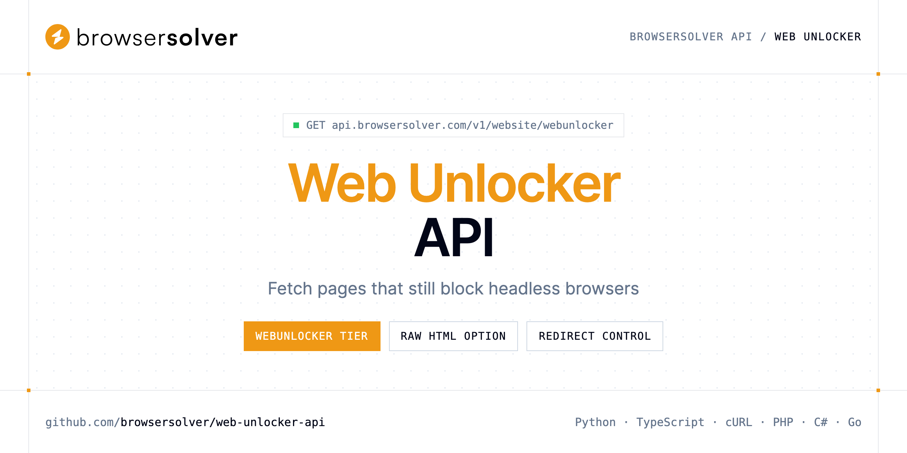

<p align="center">
  <a href="https://www.browsersolver.com"></a>
</p>

# Web Unlocker API

[](https://discord.gg/CFj3ph8aHU) [](https://app.browsersolver.com/register) [](https://app.browsersolver.com/openapi) [](LICENSE)

The **BrowserSolver Web Unlocker API** is the highest HTML fetch tier of BrowserSolver. It solves persistent bot challenges that still block the Rendering tier and returns the page HTML, for retail and marketplace hosts on your account whitelist.

- **Web Unlocker API** — BrowserSolver's highest HTML fetch tier for retail and marketplace hosts on your account whitelist.

Use it for price monitoring, catalog extraction and marketplace data when plain HTTP and headless rendering are not enough.

| Endpoint | Request | Credits |
|---|---|---|
| [Web Unlocker API](#web-unlocker-api) | `GET /v1/website/webunlocker` | 3 |

## Table of contents

- [How it works](#how-it-works)
- [Web Unlocker API](#web-unlocker-api)
- [Code examples in other languages](#code-examples-in-other-languages)
- [Use cases](#use-cases)
- [Why BrowserSolver?](#why-browsersolver)
- [FAQ](#faq)
- [Related repositories](#related-repositories)
- [Support](#support)

## How it works

1. **Create a BrowserSolver account** and copy your API key from the [dashboard](https://app.browsersolver.com/register).
2. **Call `https://api.browsersolver.com`** with the header `x-api-key: YOUR_API_KEY`.
3. **Use the result** in your app — no infrastructure to run.

```bash
export BROWSERSOLVER_API_KEY="your-api-key"
pip install requests        # Python
# TypeScript: Node.js 18+ (native fetch), run with `npx tsx file.ts`
```

## Web Unlocker API

BrowserSolver's highest HTML fetch tier for retail and marketplace hosts on your account whitelist. Solves persistent bot challenges that still block Rendering.

`GET https://api.browsersolver.com/v1/website/webunlocker` · **3 credits per request** · [API reference](https://app.browsersolver.com/openapi)

### Request parameters

| Parameter | In | Type | Required | Description |
|---|---|---|---|---|
| `query` | query | string | ✅ | Public URL to fetch with the WebUnlocker tier. Include `http://` or `https://`. The hostname must be on your BrowserSolver whitelist. |
| `allow_redirects` | query | boolean | — | Whether the unlock session should chase HTTP redirects. |
| `return_page_source` | query | boolean | — | Choose between processed markup and the exact post-unlock source. |

### Python example

```python
import os

import requests

API_KEY = os.environ["BROWSERSOLVER_API_KEY"]
HEADERS = {"x-api-key": API_KEY}

response = requests.get(
    "https://api.browsersolver.com/v1/website/webunlocker",
    headers=HEADERS,
    params={
        "query": "https://www.decathlon.fr/p/perceuse-sans-fil/_/R-p-8781921",
    },
    timeout=120,
)
response.raise_for_status()

data = response.json()
print(data)
```

### TypeScript example

```typescript
type WebUnlockerApi = string;

const headers = { "x-api-key": process.env.BROWSERSOLVER_API_KEY!, "Content-Type": "application/json" };

const params = new URLSearchParams({
  "query": "https://www.decathlon.fr/p/perceuse-sans-fil/_/R-p-8781921",
});

const response = await fetch(`https://api.browsersolver.com/v1/website/webunlocker?${params}`, { headers });
if (!response.ok) throw new Error(`HTTP ${response.status}: ${await response.text()}`);

const data = (await response.json()) as WebUnlockerApi;
console.log(data);
```

### Output example

Example response from the API reference, abridged.

```json
"<!DOCTYPE html><html lang=\"fr\"><head><meta charset=\"utf-8\"><title>Perceuse sans fil 18V | Decathlon</title><link rel=\"stylesheet\" href=\"/…"
```

## Code examples in other languages

Ready-to-run examples live in [`examples/`](examples); each reads your key from `BROWSERSOLVER_API_KEY`.

| Language | `webunlocker` |
|---|---|
| cURL (Bash) | [webunlocker.sh](examples/curl/webunlocker.sh) |
| PHP | [webunlocker.php](examples/php/webunlocker.php) |
| C# | [Webunlocker.cs](examples/csharp/Webunlocker.cs) |
| Go | [webunlocker.go](examples/go/webunlocker.go) |
| Java | [WebunlockerExample.java](examples/java/WebunlockerExample.java) |
| Ruby | [webunlocker.rb](examples/ruby/webunlocker.rb) |
| Node.js | [webunlocker.mjs](examples/nodejs/webunlocker.mjs) |

## Use cases

- **Price monitoring** — Read product pages on retail sites that challenge automated traffic.
- **Marketplace data** — Collect listings and offers from marketplace hosts on your whitelist.
- **Fallback tier** — Escalate from Crawler or Rendering only for the pages that need it.
- **Raw source capture** — Keep the exact HTML delivered after the challenge with `return_page_source`.

## Why BrowserSolver?

- **Three fetch tiers** — Crawler for static HTML, Rendering for JavaScript pages, WebUnlocker for hosts that still challenge a headless browser.
- **Know before you fetch** — the Antibot endpoint names the bot-protection vendor in front of a URL so you can choose the right tier.
- **Screenshots as a service** — PNG, JPEG, WebP or PDF, full page, 18 device presets, cookie banner and ad removal, S3 upload.
- **Technology detection** — CMS, frameworks, analytics, CDN and security tooling of any public URL.
- **Copy-paste examples** — Python and TypeScript in each README, 7 more languages in `examples/`.

## FAQ

### How do I authenticate?

Create an account on [BrowserSolver](https://app.browsersolver.com/register), copy your API key and send it in the `x-api-key` header of every request to `https://api.browsersolver.com`.

### How much does a request cost?

Credits per call: `/v1/website/webunlocker` **3**. See [BrowserSolver pricing](https://www.browsersolver.com/pricing).

### Which hosts can I unlock?

The hostname must be on your BrowserSolver account whitelist.

### When should I use WebUnlocker instead of Rendering?

Try Crawler for static HTML and Rendering for JavaScript pages first; use WebUnlocker when bot challenges persist.

### Which languages are supported?

Any language that can make an HTTP request. This README shows Python and TypeScript; the [`examples/`](examples) folder contains cURL, PHP, C#, Go, Java, Ruby and Node.js.

## Related repositories

- [JavaScript Rendering API](https://github.com/browsersolver/javascript-rendering-api)
- [Web Crawler API](https://github.com/browsersolver/web-crawler-api)
- [Screenshot API](https://github.com/browsersolver/screenshot-api)
- [Antibot Detection API](https://github.com/browsersolver/antibot-detection-api)
- [Website Technology API](https://github.com/browsersolver/website-technology-api)
- [All BrowserSolver repositories](https://github.com/browsersolver)

## Support

- 💬 Join the [Discord](https://discord.gg/CFj3ph8aHU) to ask questions and share what you build.
- 📚 Read the [API reference](https://app.browsersolver.com/openapi).
- 🔑 [Get your API key](https://app.browsersolver.com/register).

---

<p align="center">
  <a href="https://www.browsersolver.com">
    <picture>
      <source media="(prefers-color-scheme: dark)" srcset="images/logo-dark.svg">
      
    </picture>
  </a>
  <br>
  <sub>Built by <a href="https://www.browsersolver.com">BrowserSolver</a>. Examples are released under the MIT license.</sub>
</p>
